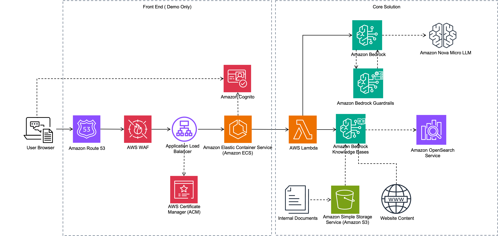

# 💡 Build an AI-powered website assistant with Amazon Bedrock

## ℹ️ Project Overview

  This project provides the reference implementation to use the Amazon Bedrock Knowledgbase to maintain the documents and also crawl the website data as knowledge base to provide the AI powered responses to user queries. 

  It deploys a complete Customer Support AI Assistant solution powered by Amazon Bedrock. The application consists of three main components:

  1. **Frontend**: A Streamlit web application deployed on AWS Fargate with Application Load Balancer
  2. **Backend**: A Lambda function that processes user queries using Amazon Bedrock
  3. **Knowledge Base**: Amazon Bedrock Knowledge Base with S3 data sources for internal and external content

> **⚠️ Production Note**: This is a reference implementation for demonstration purposes. The frontend application uses a simplified authentication model suitable for demos and prototypes. For production deployments, you should implement additional security controls, user management, and governance features aligned with your organization's specific requirements, such as:
> - Integration with enterprise identity providers (SAML, OIDC)
> - Advanced role-based access control (RBAC)
> - Audit logging and compliance monitoring
> - Session management and timeout policies
> - Multi-factor authentication (MFA)
> - Custom authorization logic for your use case


## 🎯 Business use case

This project provides the reference implementation to explains how we can build a knowledge base and create a website assistant that gives relevant answers to user questions. It helps both internal and external users.

- For internal users, such as customer service agents, the website assistant fetches relevant information from the knowledge base. Agents can resolve customer queries efficiently, leading to a better overall customer experience.

- For external users, the website assistant serves as a fast tool to find information. Customers can ask questions and get information quickly without spending time on reading through product manuals and troubleshooting articles based on the company’s website.


## 🏗️ Solution Architecture  


The solution uses the following AWS services:
- **Amazon Bedrock**: For LLM capabilities and Knowledge Base for RAG (Retrieval Augmented Generation)
- **AWS Lambda**: For backend processing of user queries
- **Amazon ECS/Fargate**: For hosting the Streamlit frontend application
- **AWS WAF**: For web application security and rate limiting
- **Application Load Balancer**: For routing traffic to the Fargate service
- **Amazon S3**: For storing knowledge base documents
- **AWS IAM**: For secure access control between services

## ⚙️ Project Structure

```
customer-support-ai/
├── backend/
│   └── functions/
│       └── cs_kb_handler/        # Lambda function for processing queries
├── frontend/                     # Streamlit web application
├── iac/
│   ├── cdk/                      # CDK infrastructure code
│   ├── deploy/                   # Deployment utilities (modular)
│   ├── deploy.py                 # Main deployment script
│   ├── cleanup.py                # Cleanup script
│   └── parameters.json           # Environment configuration parameters
```


## 🔧 Prerequisites

- AWS CDK installed (`npm install -g aws-cdk`)
- Python 3.9 or later
- AWS credentials configured with appropriate permissions
- Docker installed and running (required for local development and deployment)
  1) Windows: https://docs.docker.com/desktop/setup/install/windows-install/
  2) Mac: https://docs.docker.com/desktop/install/mac-install/
- An existing Amazon Bedrock Knowledge Base with data sources (or you can create them manually)


## 🔧 Setup

Update the `parameters.json` file with your configuration:
```json
{
    "Parameters": {
        "DEV": {
            "external_source_id": "your-external-source-id",
            "internal_source_id": "your-internal-source-id",
            "knowledge_base_id": "your-knowledge-base-id",
            "model_id": "amazon.nova-lite-v1:0",
            "ssl_certificate_arn": "",
            "allowed_ip_ranges": ["your-ip/32"],
            "allow_all_ips": false
        }
    }
}
```

**SSL Certificate**:
- Leave `ssl_certificate_arn` empty to auto-generate a self-signed certificate (for demo)
- Or provide an existing ACM certificate ARN for production use

**IP Access**:
- Configure `allowed_ip_ranges` to restrict access to specific IPs
- Set `allow_all_ips: true` to allow access from anywhere (not recommended)

## 🚀 Deployment

### Quick Start (Recommended)
```bash
cd iac
./deploy.sh
```

The deployment script will:
- Set up Python virtual environment
- Install all dependencies
- Generate SSL certificate (if not provided)
- Deploy all CDK stacks
- Create demo users with passwords

### Manual Deployment
```bash
cd iac
python3 -m venv .venv
source .venv/bin/activate  # On Windows: .venv\Scripts\activate
pip install -r requirements.txt
python3 deploy.py
```

### Demo Users

Two demo users are automatically created during deployment:
- **internal_user**: Access to all data sources (internal + external)
- **external_user**: Access to public data sources only

Passwords are displayed in the deployment output. Save them securely!

## 📌 Components

### Frontend (Streamlit Application)
- Deployed on AWS Fargate with auto-scaling
- Protected by AWS WAF with IP restrictions and rate limiting
- **Authentication**: Amazon Cognito authentication with SSL certificate (required for security)
- Streamlit interface with user type selection (Internal/External)

### Backend (Lambda Function)
- Processes user queries using Amazon Bedrock
- Connects to Bedrock Knowledge Base for RAG capabilities
- Handles different user types (internal/external) with appropriate data source filtering
- Returns formatted responses to the frontend

### Infrastructure
- VPC with public and private subnets
- ECS Cluster with Fargate service
- Application Load Balancer with Cognito authentication (when SSL certificate provided)
- **Amazon Cognito**: User Pool for authentication with demo user
- AWS WAF for web application security and DDoS protection
- IAM roles with least privilege permissions

## ⭐ Key Features

- Multiple Datasource based RAG model
- Using Webcrawler as datasource
- Auto selection of data sources for RAG model, based on the user type (Internal vs External user)

## 🧹 Cleanup

### Quick Cleanup (Recommended)
```bash
cd iac
./cleanup.sh
```

This will:
- Empty all S3 buckets
- Delete ECR images
- Destroy all CDK stacks
- Delete SSL certificates
- Clean up local files

### Manual Cleanup
```bash
cd iac
cdk destroy --all
```

## ⚙️ Customization

- To modify the frontend, update the Streamlit code in the `frontend/` directory
- To modify the backend logic, update the Lambda function in `backend/functions/cs_kb_handler/`
- To change infrastructure settings, modify the CDK stack in `iac/cdk/cdk_stack.py`
- To update environment configurations, modify `iac/parameters.json`

## 🔐 Authentication

### Cognito Authentication
The application uses Amazon Cognito for secure authentication:
- **Internal User**: `internal_user` - Access to all data sources
- **External User**: `external_user` - Access to public data only
- Passwords are generated during deployment
- Access via HTTPS with self-signed certificate (browser warning expected)

**Production Considerations**:
- Replace the self-signed certificate with a valid ACM certificate
- Integrate with your organization's identity provider (SAML/OIDC)
- Implement additional authorization controls based on your governance requirements
- Add audit logging for compliance
- Configure session timeout policies according to your security standards

## ⚡ Troubleshooting

- **CloudFormation Deployment Failures**: Check CloudFormation events in the AWS Console
- **Lambda Function Errors**: Check CloudWatch Logs for the Lambda function
- **Frontend Issues**: Check ECS task logs in CloudWatch
- **Knowledge Base Issues**: Verify your Knowledge Base and data sources are properly configured in Amazon Bedrock
- **Login Issues**: Use `internal_user` or `external_user` with passwords from deployment output
- **SSL Certificate Warning**: Accept the browser warning for self-signed certificates (demo only)
- **IP Access Denied**: Verify your IP is in `allowed_ip_ranges` in parameters.json